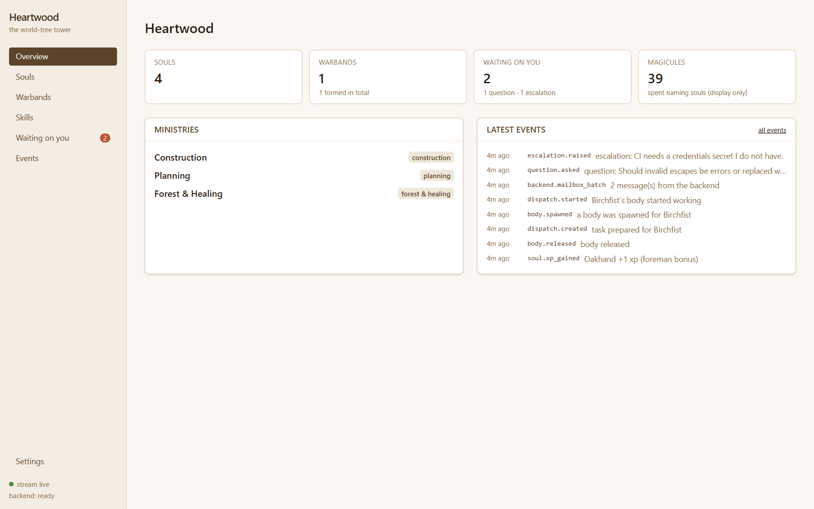
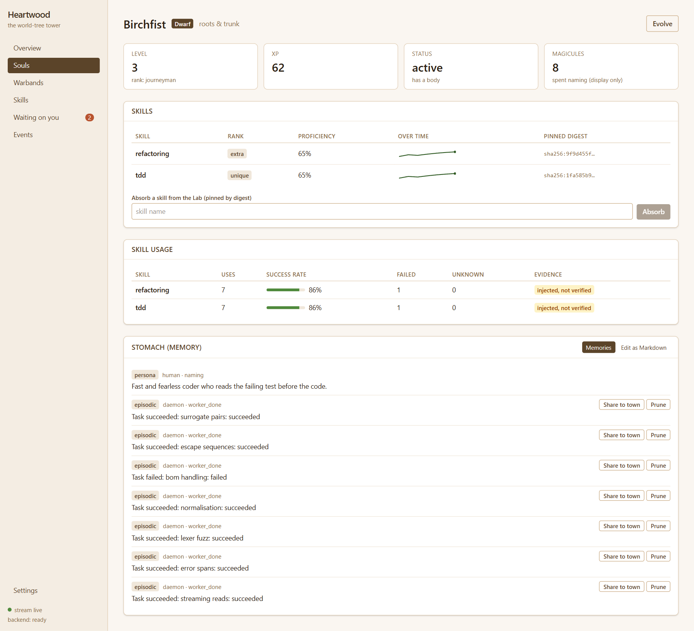
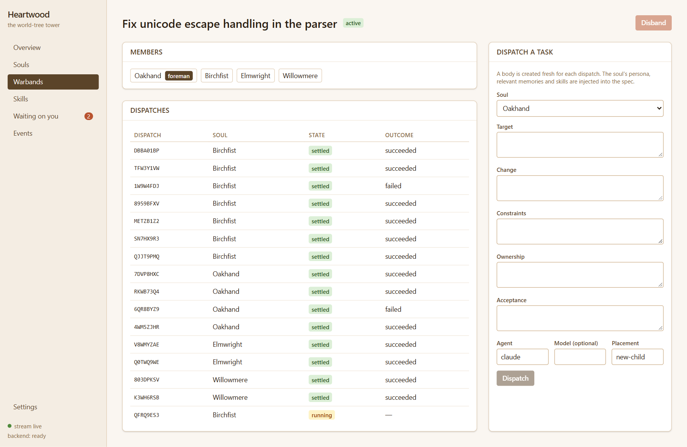
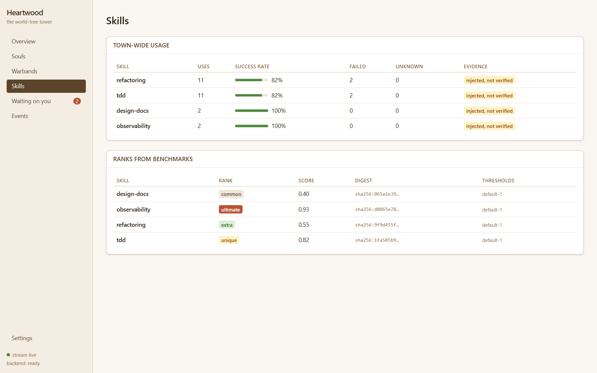

# Heartwood

A tree-themed software factory: a coordinator daemon that runs AI agents as persistent characters
(souls) inside a town hierarchy, spawning and tracking their disposable workers (bodies) in
[Orca](https://github.com/stablyai/orca) and using [grimoire-lab](https://github.com/Senpawaii/grimoire-lab) as its skill Lab.

The character mechanics borrow vocabulary only; all names and lore are original.

## Status

| Package | State |
|---|---|
| `@heartwood/protocol` | Zod event schemas (town, soul, body, warband, dispatch, backend, memory, skill) and domain enums |
| `@heartwood/core` | Append-only SQLite event log + projections, XP/level/rank rules, skill usage + proficiency, memory (FTS5, top-k injection, Markdown view, reflection), the `LabPort` and `WorkerBackend` ports with fakes, and the backend-agnostic `BackendCoordinator` |
| `@heartwood/integrations` | `OrcaBackend`: the Orca adapter over `orca … --json` (execa, argv, no shell), with contract tests built from captured Orca output and an opt-in live smoke test. `GrimoireLab`: the Lab over [`@grimoire/core`](https://github.com/Senpawaii/grimoire-lab) v0.1.0 as a library, tested against the real library |
| `@heartwood/daemon` | Fastify daemon: composition root, REST commands, SSE event stream with `Last-Event-ID` resume, backend boot/degraded mode, restart resume |
| `@heartwood/web` (`apps/web`) | React + Vite + TanStack Query + Tailwind UI: overview, souls (skills, proficiency over time, memory view/editor), warbands and dispatch, town-wide skill usage, the Sovereign's inbox, live event feed |
| `cli` | not started |

## Design notes

- **The event log is the source of truth.** Read models are projections written in the same transaction as the append and can be rebuilt (`rebuildProjections`).
- **Rank is derived from level**, never stored. `soul.ranked` is a notification only.
- **Heartbeats are not events.** The coordinator drops them at translation and keeps only the last heartbeat time.
- **Orca is an adapter, not the architecture.** The daemon, coordinator and domain depend only on the `WorkerBackend` port (`@heartwood/core`): groups, tasks, workers, a polled mailbox with batch-token acks, neutral message kinds (`done`, `escalation`, `question`, `heartbeat`, `rejected`, `other`). Events are `backend.*` and carry opaque refs. Everything vendor-specific lives in `OrcaBackend`; swapping Orca means writing another adapter.
- **Orca facts (verified against Orca 1.4.200), all contained in `OrcaBackend`.** Workers are addressed by Dispatch id (`ctx_…`). `check` returns a whole FIFO *delivery*, replayed until its id is passed as `--ack` on the **next** `check`. Refused lifecycle messages arrive as ordinary messages carrying `_orcaLifecycleRejection`; the adapter maps them to kind `rejected` and they never settle anything. A `worker-start` receipt of `outcome_unknown` means the first turn was not observed, not that it failed. Mutating commands need a sender terminal (`--from`), and Orca binds a terminal to its **most recent Run**, so the adapter provisions one idle coordinator terminal **per group** (`terminal create`), remembers it in the `KeyValueStore` it is given, names it as `--terminal` on every `check` (otherwise a daemon started inside an Orca terminal gets `consumer_fenced`), and closes it in `closeGroup`. The daemon needs no terminal of its own.
- **The Lab is grimoire-lab, as a library, and it only measures.** `GrimoireLab` maps `@grimoire/core` results to `Evidence`; Heartwood owns the policy. A rank comes from `deriveSkillRank` (configurable in `Rules.skillRank`): pass rate over *countable* trials plus lift over a no-skill baseline, and a benchmark with too few trials or too many infra errors is **inconclusive** (recorded as `skill.analyzed` with `conclusive: false`, rank left unchanged). A new skill version is promoted only if its comparison clears `Rules.promotion` (minimum countable trials per side, a minimum delta, **and a 95% Newcombe-Wilson interval for the delta that excludes zero**, `requireCiExcludesZero`, on by default) **and** says "better"; grimoire's own gate defaults are not used for promotion, and a rejection's reason states the interval. **Ranks are keyed by (skill digest, suite digest, agent)**, where the agent is `id@version model:effort`: the same skill measured under another suite or model is a separate fact, and a soul's skill shows the most recent one. **A catalog source that fails is isolated**: listing and `name@version`/digest resolves carry on from the others and `GET /skills` reports `problems`, but a *bare* name is refused with 503 while any source is down, because it might be ambiguous with something the down source holds. Pins are copied into Heartwood's content-addressed `SkillStore` on absorb, so a soul's skill survives the catalog changing; a promoted version supersedes the catalog copy for new absorbs.
- **Workers are omp, with a model and effort per dispatch.** Orca's `worker-start --model` refuses omp on older releases (fixed upstream in [stablyai/orca#24796](https://github.com/stablyai/orca/pull/24796), merged 2026-10-03; I did not verify which release first ships it, and 1.4.200 still refuses), and Orca has **no omp effort flag at all** ([#23388](https://github.com/stablyai/orca/issues/23388) stays open). omp itself has two documented ways to set both: `omp --model <id> --thinking <level>` and a `:level` suffix on the model id. Both were checked against omp's own RPC `get_state` and against the session omp recorded when run through Orca (`thinking_level_change`); omp's default is `medium`, and a level the model does not support is clamped (`minimal` became `low` on Sonnet 5.5). Orca passes `--model <id>` verbatim, so `OrcaBackend` asks Orca natively first with effort as the suffix. If Orca refuses with its "does not support launch-time model selection" error (raised before anything is created), the adapter starts `omp --model <id> --thinking <level>` itself in an Orca terminal (`terminal create --command`) and hands that terminal to `worker-start --terminal`, which Orca supervises like any worker (verified on 1.4.200; Orca waits for the agent, no readiness polling). Orca reports such a terminal as `retained / external_terminal` on release, so the adapter closes it itself; the mapping is stored durably. The fallback needs an existing worktree (placement `current` or a selector) because Orca cannot create a worktree for a pre-started terminal, and says so clearly for `new-child`/`new-top-level`. Model ids are validated against a strict pattern because they are typed into a shell. Without a model, omp uses its own configured model.
- **Backends are pull-based.** `BackendCoordinator` is the sole mailbox consumer per group: translate, commit, *then* carry the batch token forward as the ack. Replays are idempotent via a unique `(type, messageId)` index. A missing `done` never proves death; only `liveness: exited` does.
- **Skill usage** is recorded with `evidence: "injected" | "loaded"`. Today only `injected` (skill was in the spec and the dispatch settled) is produced, which can overcount; the UI must label it.
- **Foreman** is daemon logic; a member soul holds the role and earns a separate, capped bonus (never credited for decisions it didn't make).
- **The Lab boundary** is `LabPort` in `@heartwood/core`; Heartwood owns rank thresholds and the promotion rule. Open grimoire-lab prerequisites: [#14](https://github.com/Senpawaii/grimoire-lab/issues/14) [#15](https://github.com/Senpawaii/grimoire-lab/issues/15) [#16](https://github.com/Senpawaii/grimoire-lab/issues/16) [#17](https://github.com/Senpawaii/grimoire-lab/issues/17) [#18](https://github.com/Senpawaii/grimoire-lab/issues/18).
- **Windows:** spawn `orca.exe` (or `orca` resolving to it) with an argv array and no shell. `orca.cmd` shims fail with `EINVAL` without a shell.

## Screenshots









More: [souls](docs/screenshots/souls.png), [inbox](docs/screenshots/inbox.png).

## Running the daemon

```
pnpm --filter @heartwood/daemon start
```

| Variable | Default | |
|---|---|---|
| `HEARTWOOD_DATA_DIR` | `.heartwood` | SQLite database (event log, projections, adapter state) |
| `HEARTWOOD_HOST` / `HEARTWOOD_PORT` | `127.0.0.1` / `7777` | |
| `HEARTWOOD_TOKEN` | unset | Bearer token (≥16 chars) required on everything except `/health`; SSE also accepts `?token=`. Set it before listening off loopback. |
| `HEARTWOOD_SKILL_DIRS` | `grimoire/skills` | Skill catalog directories (path-delimiter separated), read-only |
| `HEARTWOOD_DEFAULT_AGENT` | `omp` | Agent for dispatches that do not name one. Workers run as [Oh My Pi](https://omp.sh) (`omp`) with a Claude model, never as `claude` directly |
| `HEARTWOOD_MAX_GROUPS` | `4` | Concurrent warbands watched (one long poll each) |
| `HEARTWOOD_ORCA_BIN`, `HEARTWOOD_ORCA_COORDINATOR_WORKTREE`, `HEARTWOOD_ORCA_POLL_TIMEOUT_MS` | `orca`, `active`, `60000` | Orca adapter |

If the backend cannot be opened or is incompatible, the daemon still starts in **degraded** mode (`backend.incompatible` is recorded, backend routes return 503); `POST /backend/connect` retries. Catalog, absorb (pin) and spec rendering work out of the box. **Benchmarks (analyze, compare) need an `AgentAdapter` and version proposals need a `SkillRewriter`; neither is configured by default, so `/skills/analyze` and `/skills/evolve` return 501** rather than fabricate results. `@grimoire/adapters` is not published yet; the intended adapter is an Orca-backed one.

**API** (JSON; errors are `{error, message}` with 400 invalid, 404 unknown, 409 rule violated, 429 group cap, 501 Lab unavailable, 502 backend failure, 503 backend down or a skill source unavailable):

- `GET /health`, `POST /backend/connect`
- `GET /events?afterSeq&types&limit`, `GET /events/stream?lastEventId&types` (SSE; `id` = event seq, resumes from `Last-Event-ID`)
- `GET|POST /ministries`, `GET|POST /souls`, `GET /souls/:id`, `POST /souls/:id/evolve|awaken`
- `GET /souls/:id/memory`, `GET|PUT /souls/:id/memory.md` (editable view), `POST /memories/:id/prune|promote`, `GET /town/memory`
- `GET /skills` (with `problems`), `GET /skills/usage|ranks` (one row per skill digest, suite and agent), `POST /souls/:id/skills` (absorb), `POST /skills/analyze|evolve`, `GET /souls/:id/skills/:skill/proficiency`
- `GET|POST /warbands`, `GET /warbands/:id`, `POST /warbands/:id/dispatches|disband`, `POST /questions/:id/answer`, `POST /escalations/:id/resolve`

Also: `GET /town` (counts, budget) and `GET /inbox` (unanswered questions, unresolved escalations). Not wired yet: the scheduled reflection pass (needs an LLM-backed `Reflector`); the daemon does not serve the built UI (use the Vite dev server/proxy).

## Running the web UI

```
pnpm --filter @heartwood/web dev        # http://localhost:5173, proxies /api to the daemon
```

`HEARTWOOD_DAEMON_URL` points the dev proxy elsewhere (default `http://127.0.0.1:7777`; the daemon's default port is 7777). If the daemon has a token, enter it under **Settings**. Every response is validated against the shared schemas in `@heartwood/protocol`, and the daemon has contract tests against the same schemas. Skill usage is labelled **injected, not verified** because it counts injected-and-settled tasks, not transcript-verified use.

## Develop

```
pnpm install
pnpm lint && pnpm typecheck && pnpm test
```

Live Orca smoke test (creates a throwaway Run with its coordinator terminal and a task, closes the terminal, never starts a worker):

```
HEARTWOOD_ORCA_LIVE=1 pnpm test
```

Node 22+, pnpm.
